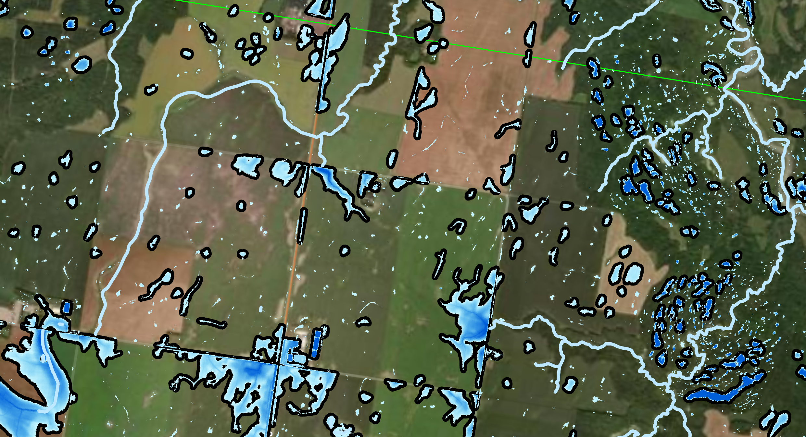

# Products Page
## Prairie Watershed Analytics

**Welcome to the Prairie Watershed Analytics Project!**

✨ If you’re looking for information on how to access and use our watershed mapping and modeling products, you’re in the right place! Please **read on**.

👟 For information on how to install and use the PWA Python Codebase on your local machine, please go to the GitHub [ReadMe File](README.md).

🔨 If you're already a user of the PWA toolkit and are interested in contributing to this project, please visit our [Contributors Page](CONTRIBUTING.md)

## What is the Prairie Watershed Analytics project?

The health of lakes and streams across the Canadian Prairies is closely connected to upstream land uses, conservation practices, and water management. Prairie Watershed Analytics (PWA) focuses on providing Canadians in the Prairies with the information they need to understand their local watershed. Watershed models can support local decision-makers and businesses with evaluating ecosystem services and connecting with environmental incentive programs. Prairie Watershed Analytics is making this practice simple and accessible using open data and tools to automate and scale watershed modeling tailored to the Prairies. 

You can visit our website for more information on the [Prairie Watershed Analytics project](https://www.iisd.org/projects/prairie-watershed-analytics), the [International Institute for Sustainable Development](https://www.iisd.org/), and the [IISD Experimental Lakes Area](https://www.iisd.org/ela/).

Questions? Please contact us at eladata@iisd-ela.org

## Our Products

## The PWA Ponding Data Product

The PWA Ponding Data Product is a spatial dataset that maps depressions and potential ponding areas across your watershed. For each site, it provides key measurements, including area, depth, and storage volume—all derived from LiDAR elevation data. Our data generation tool uses a fast, streamlined calculation method, designed to give you reliable, actionable information without requiring advanced technical expertise on your end. 

⭐ New! Version 1.2 of the PWA HydroConditioning Tool now provides estimates of the contributing catchment for each identified wetland or ponded area.

The dataset currently covers watersheds across southern Manitoba and wherever high resolution Digital Elevation Models and watershed delineations are available. Lower-resolution versions can also be generated for other parts of the prairies and Canada. 🍁 

### What to use the PWA Ponding Data Product for 
PWA maps are well suited for: 
- Identifying sites for water retention, wetland restoration, or other structural Best Management Practices (BMPs) that might warrant investigation. 
- Sharing preliminary data to inform conversations with land managers or technical specialists. 
- Estimating and comparing total water retention in different sub-catchments of your watershed for early planning purposes (such as in Integrated Watershed Management Plans). 

The PWA Ponding Product is not suitable for all wetland mapping applications. Please read the section below and carefully review the product disclaimer before using the product. For the following applications, first consider these suggested alternatives: 
- [Dynamic, high precision retention modeling in the prairies](https://research-groups.usask.ca/hydrology/modelling/wdpm.php)  
- [Wetland mapping for biodiversity assessments](https://www.canada.ca/en/environment-climate-change/services/wildlife-habitat/canadian-national-wetland-inventory.html) 

## The PWA Flow Modeling Product

Watershed managers have access to more data than ever on the volume and quality of water in their rivers. They also have access to a growing number of watershed modeling tools to process that data. However, model generation and optimization can be intensive both in terms of model developer time and computational requirements. 

The PWA Flow Modeling Product provides decision-makers with a simplified hydrological model of their watershed. These hydrological models can be paired with data on surface water storage, or on net phosphorus sources and in‑stream phosphorus monitoring data for an empirical analysis of spring flows and related phosphorus exports at the watershed scale. 

### What to use the PWA Flow Modeling Product for 

PWA flow models are well suited for:
- Understanding the distribution of flows across a watershed during formative spring flood events (return periods of 2 to 10+ years).
- Estimating the response of the river to changes in surface storage at a watershed or sub-watershed scale.
- Estimating flows and phosphorus loads at ungauged sites.

The PWA Flow Modeling Product is not suitable for all prairie hydrological modeling applications. Please read the section below and carefully review the product disclaimer before using the product. 
How do I know I am using the tool correctly? 
- This data is intended primarily for exploratory research, such as surveying a wide range of potential sites to select a smaller subset for more intensive field investigation. Because the underlying datasets (elevation data in particular) have limited accuracy, these maps should always be cross-referenced with on-site field observations to identify and correct potential errors.  
- This data is not suited for high-risk applications such as final design of landscape changes and construction projects, or for floodplain mapping, asset risk assessments, or other engineering, financial, or legal purposes. In addition, this data is not intended for estimating storage volumes for lakes or year-round (class 1) wetlands. 
- Before using this information for decision-making, please review our full guidelines and terms of use for a comprehensive understanding of these technical constraints. 

## Accessing and using PWA Products
Request a dataset or model for your entire watershed 
- Submit a request form to begin a quick screening of water retention options across the landscape. Please note that while we support watersheds up to 10,000 km², the complexity of your specific request may require us to contact you for further details.
- Fully processed datasets and models are provided at a fee (ranging from $0 to > $1000CAD depending on the nature of the request). Sample datasets are available on request.
- Processing time for paid data requests is typically 10 business days or less. 

## Need something more tailored? Want to collaborate?  
- For farm-level analysis or modelling new landscape features at a specific site, an open-source Python package (LINK) is available for more advanced applications. Demos, support, and mapping services are available on request — just reach out to {e-mail}. 
 

